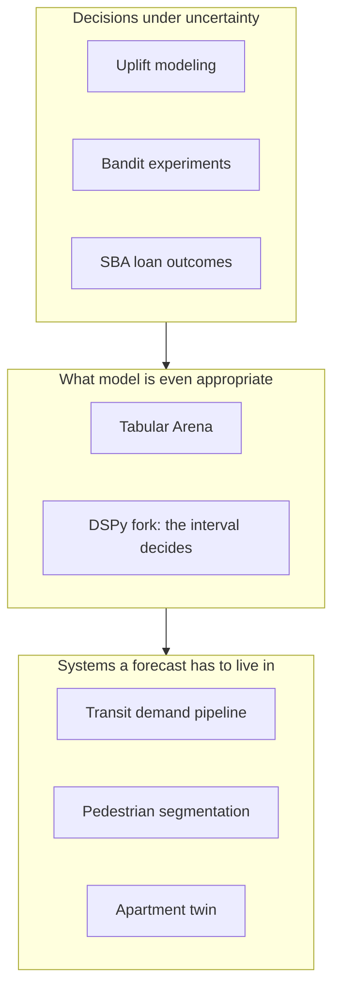

# Pranav Reveendran

Data scientist working on causal inference, experimentation, and the systems around a model. San Jose. [LinkedIn](https://www.linkedin.com/in/pranav-reveendran/). Open to work.

The thread through the pinned work: do not trust a score that was not earned by a decision. Uplift asks who changes. The bandit project asks which variant deserves the next visitor. Tabular Arena asks when a foundation model is actually worth it. The transit and vision projects are the same habit applied to operations and to a street scene.

## How the work connects

## Start here

| Project | The decision it is about |
|---|---|
| [uplift-modeling-causal-ml](https://github.com/pranav-revee/uplift-modeling-causal-ml) | Who changes because of a treatment, under a budget |
| [ai-bandit-experimentation-airbnb](https://github.com/pranav-revee/ai-bandit-experimentation-airbnb) | Which listing variant should get the next visitor |
| [tabular-arena](https://github.com/pranav-revee/tabular-arena) | When trees still beat foundation models on tables |
| [dspy](https://github.com/pranav-revee/dspy) | A fork where the confidence interval ships, and the model only explains |
| [Real-time-transit-demand-forecasting](https://github.com/pranav-revee/Real-time-transit-demand-forecasting) | Demand for bikes, subway, PATH, ferry, and weather |
| [safe-urban-perception-planning](https://github.com/pranav-revee/safe-urban-perception-planning) | Finding pedestrians a baseline U-Net misses |
| [apartment-twin](https://github.com/pranav-revee/apartment-twin) | A phone walkthrough as a 3D record of a unit |

## Toolkit

Python, SQL, causal inference, experimentation design, forecasting pipelines, computer vision, and TypeScript when the result needs an interface.
